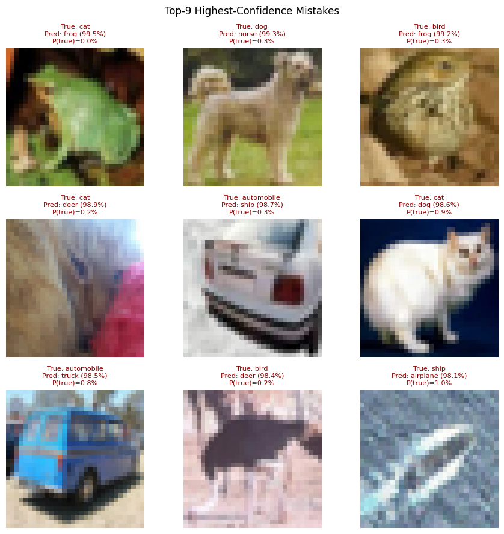
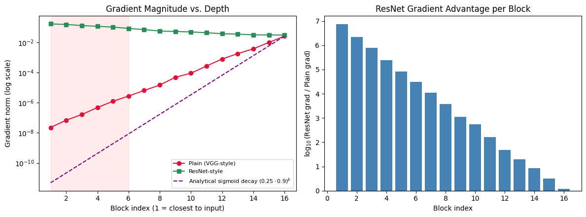
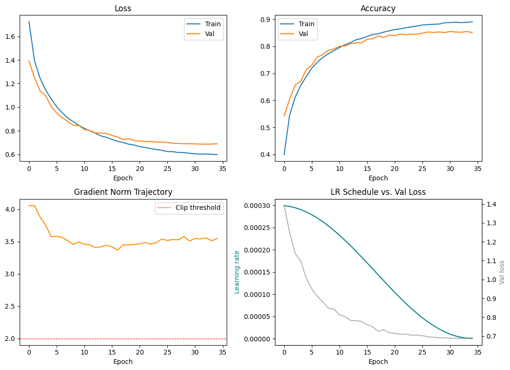
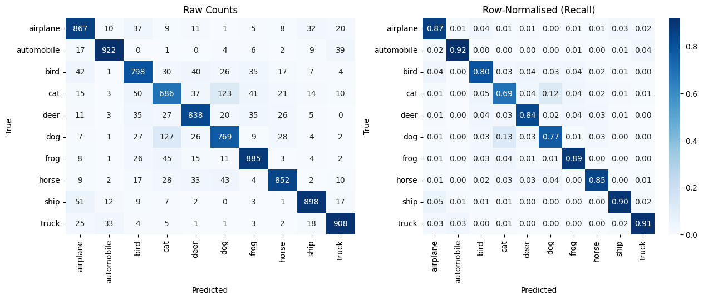
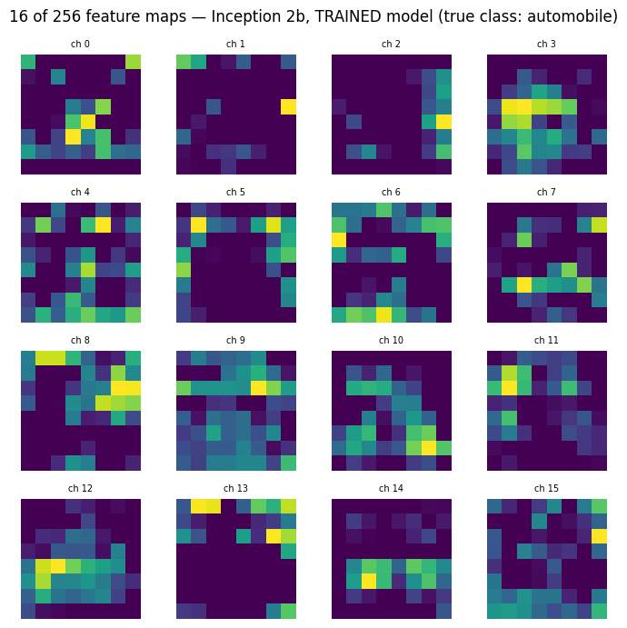

<div align="center">

# CIFARInception

**A 0.55M-parameter Inception-style CNN, built from scratch in PyTorch for native 32×32 images**

[](https://pytorch.org)
[](#results)
[](#architecture)
[](https://github.com/Mazen-devs/cifar-inception-from-scratch/actions/workflows/tests.yml)
[](LICENSE)



*The model was 99.48% sure this cat was a frog. Working out why taught me more than the headline accuracy did.*

</div>

---

## TL;DR

| | |
|---|---|
| **Task** | 10-class image classification on CIFAR-10 at its **native 32×32 resolution** (no upscaling to 224×224) |
| **Model** | Custom Inception-style CNN: conv stem + **5 Inception modules** + global average pooling, **549,802 parameters** (≈0.4% of VGG-16's ~138M) |
| **Result** | **84.23% test accuracy, macro F1 0.842**, trained in **10.4 minutes** on one Tesla T4 |
| **What makes it interesting** | It starts with a measured gradient-flow experiment, explains every design choice, and ends with an honest error analysis and an ablation the model did *not* win |


## Why this architecture?

**1. Plain deep stacks lose their gradient.** Before building anything, I measured gradient magnitude per block in a 16-block plain (VGG-style) stack and in a residual stack. In the plain stack the gradient at the first block was **8.84 × 10⁻⁷** of the gradient at the last block, roughly six orders of magnitude of decay. The residual stack kept a ratio of **5.5**.



**2. CIFAR objects appear at very different scales**, from a distant airplane a few pixels wide to a close-up frog filling the frame. Inception modules look at the same input through 1×1, 3×3, 5×5 and pooled branches in parallel and concatenate the results, so the network does not have to pick one receptive field per layer.

**3. 1×1 bottlenecks make the 5×5 branch affordable.** A naive 5×5 convolution from 256 to 256 channels at 32×32 costs about **1.68 G multiply-accumulates**. Reducing to 32 channels first with a 1×1 convolution cuts that to about **218 M**, roughly **7.7× cheaper**.

## Architecture

```
input 3×32×32
 └─ stem: Conv3×3(32) → Conv3×3(64) → MaxPool        → 64×16×16
     ├─ Inception 1a → 112 ch   ┐
     ├─ Inception 1b → 128 ch   ┘ → MaxPool          → 128×8×8
     ├─ Inception 2a → 224 ch   ┐
     ├─ Inception 2b → 256 ch   ┘ → MaxPool          → 256×4×4
     └─ Inception 3a → 304 ch
 └─ Global average pool → Dropout(0.4) → Linear(304→10)
```

Each Inception module has four branches: `1×1`, `1×1 → 3×3`, `1×1 → 5×5`, and `3×3 max-pool → 1×1`. Every convolution is Conv-BN-ReLU without bias. The full definition is in [`src/model.py`](src/model.py), and [`tests/test_model.py`](tests/test_model.py) checks the parameter count (549,802), the shape trace and that gradients reach the stem.

## Training setup

| Choice | Value | Why |
|---|---|---|
| Split | Stratified 45k train / 5k validation, official 10k test | test set untouched until the end |
| Augmentation | random crop (pad 4) + horizontal flip, train only | |
| Optimizer | Adam, lr 3e-4, weight decay 1e-4 | |
| Schedule | Cosine annealing over 35 epochs | smooth decay, no plateau tuning |
| Loss | Cross-entropy with label smoothing 0.05 | discourages over-confident logits |
| Stability | Gradient clipping at max-norm 2.0 | |
| Checkpoint | best validation accuracy (85.48%) | |
| Seed | 42 (torch, numpy, random) | |



## Results

| Metric | Value |
|---|---|
| Test accuracy | **84.23%** (test loss 0.7155) |
| Macro precision / recall / F1 | 0.842 / 0.842 / 0.842 |
| Best class (recall) | automobile 0.922, truck 0.908, ship 0.898 |
| Hardest class (recall) | **cat 0.686**, dog 0.769, bird 0.798 |
| Training time | 10.4 min, Tesla T4 |



### Error analysis: the most confident mistakes

The three most confident errors were a **cat predicted as a frog at 99.48%**, a dog predicted as a horse at 99.25%, and a bird predicted as a frog at 99.17%. Cat and dog are the weakest classes, which matches their shared fur texture and pose variety at 32×32. Label smoothing (0.05) did not stop these extreme confidences, so the model is miscalibrated on some inputs. That is the first thing I would fix next (see below).

I also visualised feature maps from Inception module 2b with forward hooks to check that the trained filters respond to object structure rather than background.



### An ablation my model did not win

To be fair to simpler designs, I trained three networks with the **same 5-epoch budget**:

| Model (5 epochs, equal budget) | Params | Test acc |
|---|---|---|
| VGGSmall | 288,746 | **72.55%** |
| CIFARInception | 549,802 | 70.89% |
| ResNetSmall | 298,698 | 66.41% |

The plain VGG-style net converged fastest under a tiny budget. I read this as a statement about **early convergence speed, not final capability**, but I did not train the baselines for the full 35 epochs, so I make no claim about which architecture is best overall. That comparison is on the to-do list.

## What I learned

- Measuring a problem (vanishing gradients) before designing around it makes the design argument much stronger than citing papers alone.
- Accuracy hides the interesting part: per-class recall and confident mistakes told me where the model actually struggles.
- Report the experiment that does not flatter you. The 5-epoch ablation changed how I describe the model.
- I logged the pre-clipping gradient norm and it stayed between about 3.4 and 4.1, above the 2.0 threshold, so clipping was active on most batches. I would test a higher threshold or no clipping next time.

## Next steps

- [ ] Measure calibration (expected calibration error and a reliability diagram) and apply temperature scaling on the validation set
- [ ] Train VGGSmall and ResNetSmall for the full 35 epochs for a fair comparison
- [ ] Run several seeds and report mean ± standard deviation instead of a single run
- [ ] Export a small inference demo

## Run it

```bash
git clone https://github.com/Mazen-devs/cifar-inception-from-scratch.git
cd cifar-inception-from-scratch
pip install -r requirements.txt
python src/model.py           # prints the parameter count and shape trace
pytest -q                     # architecture tests (CPU, a few seconds)
```

To reproduce training, open [`notebooks/cifar_inception.ipynb`](notebooks/cifar_inception.ipynb) in Google Colab with a GPU runtime and place the official `cifar-10-python.tar.gz` ([download](https://www.cs.toronto.edu/~kriz/cifar.html)) next to the notebook. The notebook is the executed version, so every number above can be checked against its printed outputs.

## Repository layout

```
├── notebooks/cifar_inception.ipynb   executed notebook: gradient experiment, training, evaluation, ablation
├── src/model.py                      CIFARInception, InceptionModule, ConvBnRelu
├── tests/test_model.py               parameter count, shapes, gradient flow
└── assets/                           figures exported from the notebook
```

## References

Szegedy et al., *Going Deeper with Convolutions* (2015) · He et al., *Deep Residual Learning* (2016) · Ioffe & Szegedy, *Batch Normalization* (2015) · Guo et al., *On Calibration of Modern Neural Networks* (2017) · Krizhevsky, *Learning Multiple Layers of Features from Tiny Images* (2009)

---

<sub>Built by Mazen Mehna as part of a BSc Computer Science (AI) at Taylor's University. MIT licensed.</sub>
